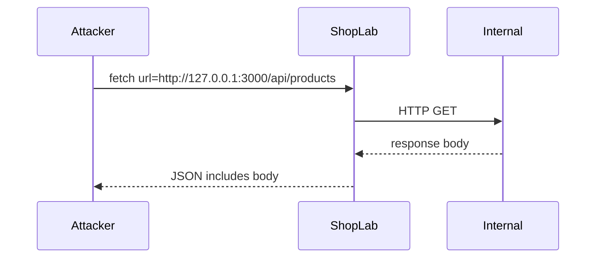

# Week 6 – Secrets, dependencies and configuration (Lab slide content)

Use one `##` heading per slide. Speaker notes are in blockquotes.

---

## Week 6: Configuration and hardening

ShopLab Lab 6

- Safe error responses vs server logs
- SSRF on `/api/tools/fetch`
- File uploads and path traversal
- Security headers and debug routes
- `.env` hygiene and `npm audit`

> Lab 5 fixed **who can access what**. Today: **how the app is configured** — errors, outbound HTTP, uploads, headers, and dependencies.

---

## Learning outcomes

By the end of this lab session you can:

- Show why stack traces in JSON help attackers
- Demonstrate SSRF using the Tools page or curl
- Exploit unsafe upload naming, then fix path traversal
- Add missing security headers and gate debug endpoints
- Run `npm audit` and explain lockfile + `.env.example`

> Full steps: [`LAB6.md`](LAB6.md). Lecture depth: [`WEEK6-SLIDES.md`](WEEK6-SLIDES.md).

---

## Start here

1. `cd shoplab && npm run setup && npm start`
2. Open **http://localhost:3000**
3. Tag **`week-6-start`** if you need the teaching build (Lab 5 fixes + Lab 6 bugs)
4. Log in as **alice@shoplab.test** / **alice123**

> ~3 hours. UI: **Tools** in the nav. curl-first demos work without the proxy.

---

## Configuration is security

Misconfiguration often means:

- Debug still on in “production”
- Secrets in repo or default fallbacks
- Server fetches attacker-chosen URLs (SSRF)
- User files written where the web server serves them

Code can be “correct” and still leak because of **settings and routes**.

---

## Part A – Verbose API errors

Teaching build: [`errorHandler.js`](server/src/middleware/errorHandler.js) sends **`stack`** (and sometimes SQL hints) to the client.

Attackers learn:

- Framework and file paths
- Library versions from stack frames
- Database error text

**Fix:** log fully on the server; return a generic message to the browser.

---

## Demo: intentional crash

```bash
curl -s http://localhost:3000/api/debug/crash | jq
```

Before your fix: JSON includes **`stack`** under `server/src/...`.

After your fix: no stack in the response (or route disabled in production mode).

> Compare with [`LAB6.md`](LAB6.md) Part A. Optional: break a request and confirm the handler still does not leak.

---

## Logging vs responding

| Internal (logs) | External (HTTP body) |
|---|---|
| Stack trace | `"Something went wrong"` |
| SQL message | `"Invalid request"` |
| User id, IP | Opaque `requestId` (optional) |

ShopLab React shows `err.message` from the API — the API must not send secrets or stacks.

---

## Part B – SSRF in one slide

**Server-side request forgery:** your **server** performs HTTP (or other) requests to a URL the **attacker** supplies.

The browser never talks to `127.0.0.1` — but the app often can.

Lab endpoint: `GET /api/tools/fetch?url=...` in [`tools.js`](server/src/routes/tools.js).

---

## SSRF flow



> In cloud: replace loopback with metadata IP `169.254.169.254` in discussion — do not attack real clouds in class.

---

## Demo: SSRF on loopback

Log in as Alice, then:

```bash
curl -s -b alice.jar \
  'http://localhost:3000/api/tools/fetch?url=http://127.0.0.1:3000/api/products'
```

Or use **Tools → Preview URL** with the same URL.

Before fix: product JSON appears in the response **`body`** field.

---

## SSRF defences (pick one policy)

Document your choice in the write-up:

- **Block** private IPs, link-local, metadata, `file:`
- **Allowlist** only `https://` hosts you trust
- Disable or validate **redirects**
- Network rules: app tier cannot reach metadata

Return **400** for disallowed targets — not a stack trace.

---

## Part C – Unsafe uploads

`POST /api/uploads?name=...` in [`uploads.js`](server/src/routes/uploads.js):

- Client chooses **filename**
- Files may be served from **`/uploads/`** (static mount in [`app.js`](server/src/app.js))

Risks: path traversal, web-shell if combined with execution, disk fill.

---

## Path traversal upload

Try in **Tools** or curl:

```bash
# After login with CSRF/JWT as in LAB6.md
name=../../../tmp/shoplab-lab6-proof.txt
```

Before fix: file may appear **outside** `server/uploads/`.

**Fix:** basename or UUID; verify resolved path stays under upload root; reject `..`.

---

## Upload hardening checklist

- Max **size** (already 5mb raw limit — tune if needed)
- **Type** allowlist (magic bytes, not extension alone)
- **Random** stored name; optional auth on download
- Do not expose `uploads/` as wide-open static without controls

> Stretch: [`LAB6-EXTENSIONS.md`](LAB6-EXTENSIONS.md) — authenticated download route.

---

## Part D – Security headers

[`securityHeaders.js`](server/src/middleware/securityHeaders.js) — teaching build sets **CSP only** (from Lab 3).

Add in the lab:

- `X-Content-Type-Options: nosniff`
- `Referrer-Policy: strict-origin-when-cross-origin` (or similar)
- Comment when **`Strict-Transport-Security`** applies (HTTPS + production)

```bash
curl -sI http://localhost:3000/ | grep -iE 'content-security|x-content|referrer|strict'
```

---

## Debug routes are not “internal only”

[`/api/debug`](server/src/routes/debug.js):

- `/echo` — headers demo (Lab 1+)
- `/config` — environment **hints** (default session secret?)
- `/crash` — triggers verbose error

**Fix:** **404** when `NODE_ENV=production`, or remove mount — document your rule.

```bash
curl -s http://localhost:3000/api/debug/config | jq
```

---

## Part E – `.env` and secrets (lab checklist)

- Copy [`.env.example`](.env.example) → **`.env`** (gitignored)
- Set long random `SESSION_SECRET` and `JWT_SECRET`
- Never commit `.env`; deleting a line does **not** remove secrets from **git history**

Optional: fail startup if required vars missing when `NODE_ENV=production`.

> Tie to lecture: rotation playbook if a key was ever pushed.

---

## Part F – `npm audit` and dependencies

From `shoplab/server/`:

```bash
npm ls --depth=0
npm audit
```

Know the difference:

| Direct | In your `package.json` |
| Transitive | Pulled by dependencies |
| Lockfile | Exact tree for `npm ci` |

Write up **one** audit finding or a clean result + what you would do in CI.

---

## Lab 6 walkthrough

| Step | Task |
|---|---|
| 1 | Reproduce verbose error + `/debug/config` |
| 2 | Reproduce SSRF to local `/api/products` |
| 3 | Reproduce upload / path traversal |
| 4 | Fix error handler, SSRF, uploads |
| 5 | Headers + debug gating |
| 6 | `.env` + `npm audit` notes |
| 7 | Proof table; `npm test` |

> Schedule table in [`LAB6.md`](LAB6.md).

---

## Files students change

- `server/src/middleware/errorHandler.js`
- `server/src/routes/tools.js`
- `server/src/routes/uploads.js`
- `server/src/middleware/securityHeaders.js`
- `server/src/routes/debug.js` and/or `server/src/app.js`
- Local `.env` (not committed)

> Look for `// Lab 6 teaching build:` comments in the starter on **`week-6-start`**.

---

## Proof table (after fixes)

| Check | Expected |
|---|---|
| `GET /api/debug/crash` | No **stack** in JSON (or debug off) |
| `GET /api/tools/fetch?url=http://127.0.0.1:...` | **400** blocked |
| Traversal upload name | **400** or file only under uploads |
| Response headers | nosniff + Referrer-Policy |
| Bob / anonymous debug | Your documented policy |
| `npm test` | Pass |

---

## Mapping to standards

- **OWASP A05** Security Misconfiguration
- **OWASP A06** Vulnerable and Outdated Components
- **CWE-918** Server-Side Request Forgery (SSRF)
- **CWE-22** Path traversal (uploads)
- Information exposure via **verbose errors**

> Submit: proof table, file list, short write-up per [`LAB6.md`](LAB6.md).

---

## Recap

- **Errors:** detail in logs, not in API JSON
- **SSRF:** control outbound fetches from the server
- **Uploads:** never trust filenames; control storage and serving
- **Headers + debug + env + audit:** production readiness habits

Optional: [`LAB6-EXTENSIONS.md`](LAB6-EXTENSIONS.md)

> Q&A; office hours for SSRF URL parsing and upload path checks.
