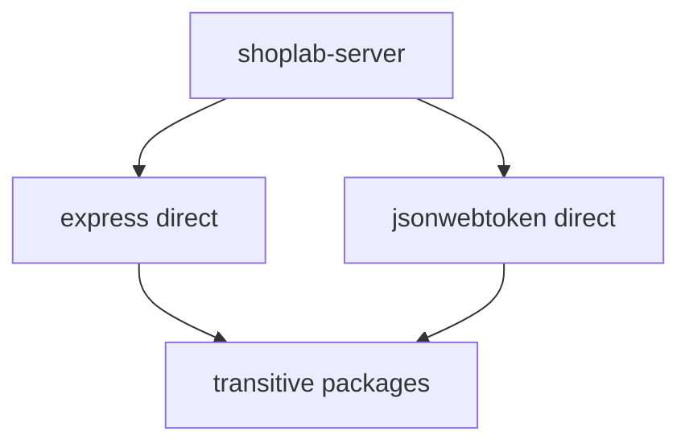
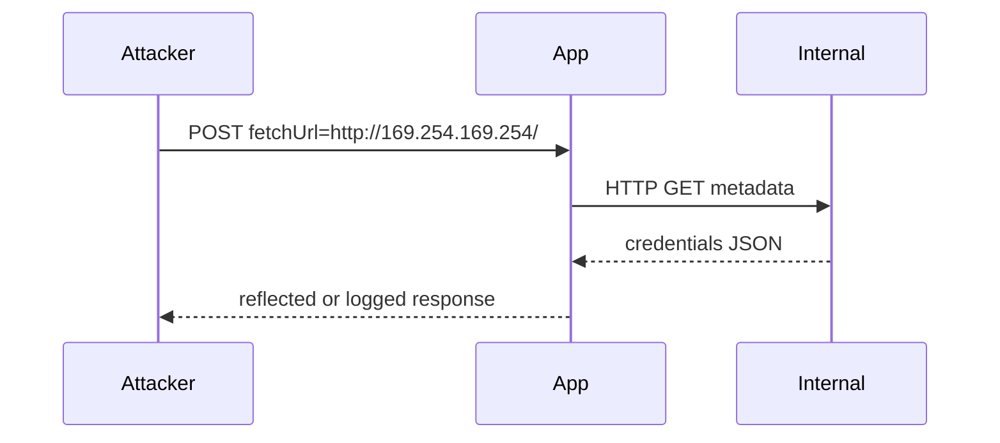

# Week 6 – Secrets, dependencies and configuration (slide content)

Use one `##` heading per slide. Speaker notes are in blockquotes (**Macedonian**). Slide bullets stay in **English**.

## How to use this deck (4 hours)

Suggested timetable (adjust to your cohort):

| When | Block | Slides (approx.) |
|---|---|---|
| 0:00–0:50 | Secrets in source control | Opening + Block 1 |
| 0:50–1:00 | **Break** | — |
| 1:00–1:45 | Environment variables and key exposure | Block 2 |
| 1:45–2:40 | npm dependencies and supply chain | Block 3 |
| 2:40–2:55 | **Break** | — |
| 2:55–3:35 | HTTPS and security headers | Block 4 |
| 3:35–4:20 | Errors, uploads, SSRF | Block 5 |
| 4:20–4:45 | Configuration mistakes, recap, Q&A | Block 6 |

Have ShopLab running (`cd shoplab && npm start`) for live demos in Blocks 2–4.

---

## Week 6: Secrets, dependencies and configuration

ShopLab course · Lecture (4 hours)

- Configuration is security
- Secrets, `.env`, and git history
- npm dependency graph and audit
- Headers, HTTPS, safe errors
- Uploads, SSRF, production misconfiguration

> Добредојдовте на Week 6. Техничките термини (`git`, `npm`, `SSRF`) може да ги оставите на англиски; објаснувањето е на македонски. Оваа недела не е „уште еден bug“ — туку системски грешки: што ставаме во репото, што инсталираме, и како е конфигуриран серверот. Времетраење: ~4 часа со две паузи.

---

## Learning outcomes

By the end of this session you can:

- Explain why deleting a secret from a file does **not** remove it from git history
- Use `.env`, `.env.example`, and `.gitignore` correctly
- Follow a practical checklist when an API key has been exposed
- Describe direct vs transitive npm dependencies and read a lock file at a high level
- Run and interpret `npm audit`; recognise typosquatting risk
- Name important security headers and why HTTPS matters in production
- Design API errors and file uploads that do not help attackers
- Explain SSRF in one sentence and list two defences
- Spot debug mode, default passwords, and exposed admin surfaces

> Студентите треба да можат да ги поврзат овие точки со ShopLab: `.env.example`, `SESSION_SECRET` во `app.js`, CSP од Lab 3, admin/debug рути од Lab 5. Напоменете: нема нов lab deliverable — фокусот е лекција и домашна рефлексија.

---

## Bridge from Labs 4 and 5

| Earlier lab | This week |
|---|---|
| Lab 4 – JWT and session secrets | Where those secrets **live** and what if they leak |
| Lab 5 – `/api/admin`, roles | Why **configuration** exposes admin/debug in teaching builds |
| Lab 3 – CSP header in `app.js` | Part of **defence in depth** with HTTPS and other headers |

> Кратко повторете: Lab 4 одговори „кој си?“, Lab 5 „што смееш?“. Week 6 праша „што е исчркано во config и dependency tree?“ — често најлесните кражби се од leaked key или `npm install` на погрешен пакет.

---

## Block 1 – Secrets and source control

*(~50 minutes)*

---

## What is a secret?

Treat as **secret** (never in git, never in client code):

- API keys (Stripe, SendGrid, OpenAI, …)
- Database connection strings with passwords
- JWT signing keys, session cookie secrets
- Private keys (SSH, TLS, signing)
- Webhook signing secrets, OAuth client secrets

**Not secret:** public URLs, product ids, usernames (often), feature flags without credentials.

> Аналогија: secret е какo PIN на картичка — еднаш е на Instagram story, веќе не е само ваш. Разлика password vs API key: keys често немаат „lockout“ — attacker користи key додека вие ротирате.

---

## The usual accident

1. Developer adds `API_KEY=sk_live_...` to `config.js`
2. `git commit` → `git push`
3. Realises mistake → deletes line → new commit
4. Believes the secret is **gone**

**Reality:** every commit is still fetchable from history.

> Прашајте: „Кој некогаш pushнал нешто и потoa force-push или revert?“ Не стигматизирајте — нормализирајте процес. Клучна порака: **git е append-only ledger of snapshots**, не „тековна верзија на датотека“.

---

## How git remembers

- Each commit stores a **snapshot** (tree of blobs)
- Old blob with the key still exists until history is rewritten **and** all copies disappear
- Anyone who cloned before the fix still has the object locally
- GitHub/GitLab keep refs, forks, CI logs, issue attachments

```bash
git log -p -- config.js    # shows the key in an old patch
git show <commit>:config.js
```

> Дemo (на synthetic repo или стар commit): `git log -p` — студентите визуелно го гледаат key во diff. Објаснете: `git revert` не брише history; само додава commit што го отстранува текстот од HEAD.

---

## `.gitignore` does not fix the past

`.gitignore` only stops **new** untracked files from being added.

| Action | Effect on already-committed secret |
|---|---|
| Add path to `.gitignore` | Stops future `git add` of that file |
| Delete file and commit | Secret still in **old commits** |
| `git rm --cached .env` | Removes from **next** commit, not history |

> ShopLab: `.gitignore` веќе игнорира `.env` — покажете [`shoplab/.gitignore`]. Прашање: „Дали `.env.example` треба да има вистински secrets?“ — не, само placeholders.

---

## Why force-push is not enough

After history rewrite, secrets may still exist on:

- Teammates’ laptops (old clones)
- Forks on GitHub
- CI build logs that printed env vars
- Search engine / GitHub code search caches
- Backup tapes, incident tickets with pasted keys

**Assume the secret is compromised** once it touched a remote.

> Не влегувајте длабоко во `git filter-repo` на live student repo — објаснете **concept**: rewrite history + rotate key + invalidate tokens. Legal/compliance: некои фирми мораат да пријават breach.

---

## Finding secrets in repos

Automated approaches (teams use one or more):

- **GitHub/GitLab secret scanning** – push alerts, partner revocation
- **gitleaks**, **trufflehog** – scan history locally or in CI
- Pre-commit hooks – block patterns before push

Human review: code review checklist „no literals that look like keys“.

> Activity (5 min): во pairs — наведете 3 места каде key може да leak освен git (Slack, Jira, Postman collection export). Дискусија.

---

## Prevention: never commit real `.env`

Pattern used in ShopLab:

- **`.env.example`** – committed, safe defaults, documents variable names
- **`.env`** – local only, in `.gitignore`
- Production – platform env vars (Render, Fly, Azure, …), not files in the image

> Отворете [`shoplab/.env.example`]: `SESSION_SECRET`, `JWT_SECRET` — за lab е OK „change-me“, во production мора random high-entropy.

---

## Secret managers (overview)

For production at scale:

- Cloud: AWS Secrets Manager, GCP Secret Manager, Azure Key Vault
- SaaS: HashiCorp Vault, 1Password Secrets Automation
- CI: inject secrets as env at runtime, never echo in logs

Developers still use `.env` **locally**; pipeline pulls from vault.

> Не барајте од студентите имплементација — доволно е да знаат: **file in repo = wrong place for production secrets**.

---

## Extended: secrets beyond git

Other leak paths:

- **Docker layers** – `ENV API_KEY=...` in Dockerfile committed to git
- **CI logs** – `echo $SECRET` or verbose npm scripts
- **Screenshots** and screen shares during demos
- **Client bundles** – `VITE_*` env vars embedded in frontend JS
- **Error reports** – Sentry extra data with connection strings

> ShopLab client: нема production API keys — но ако некој стави `VITE_STRIPE_KEY` во Vite, цел key е во `dist/`. Правило: **browser cannot keep secrets**.

---

## Block 1 recap

- Secrets in git **persist in history**
- `.gitignore` is forward-looking only
- Rotate and assume breach after any exposure to a remote
- Scan, hooks, `.env.example` + vault in prod

> **Пауза ~10 min** (следен блок: environment variables и incident playbook).

---

## Block 2 – Environment variables and exposure

*(~45 minutes)*

---

## Twelve-factor config

[12-factor app](https://12factor.net/config): **config in environment**, not in code.

- Different values per deploy (dev / staging / prod) without code changes
- No secrets in the artifact (container, zip)
- Easy to rotate without redeploying logic (only env)

> Македонски timovi често мешаат „config file на server“ со „config in repo“ — разликата е **од кade runtime го чита**.

---

## ShopLab: loading `.env`

Server [`package.json`](server/package.json) scripts use Node 22:

```text
node --env-file-if-exists=../.env src/index.js
```

- File lives in `shoplab/.env` (copy from `.env.example`)
- If missing, app still runs with in-code fallbacks (teaching risk)

> Demo: стартувајте без `.env` — app работи. Прашање: зошто е тоа опасно во production?

---

## Environment variable names in ShopLab

From [`.env.example`](.env.example):

| Variable | Purpose |
|---|---|
| `PORT` | API port |
| `SESSION_SECRET` | Signs session cookie |
| `JWT_SECRET` | Signs login JWT (Lab 4+) |
| `CORS_MODE` | `off` or `reflect` (lecture demo only) |

> `CORS_MODE=reflect` — веќе го користевте Week 1; повторете: **само кога лекторот побара**, never in production.

---

## Unsafe defaults in code

From [`server/src/app.js`](server/src/app.js):

```javascript
secret: process.env.SESSION_SECRET || 'change-me-in-lab',
```

- Fallback helps local lab setup
- In production: missing env → **predictable secret** → session forgery

**Fix:** fail fast if required env vars missing in production.

> Покажете pattern: `if (process.env.NODE_ENV === 'production' && !process.env.SESSION_SECRET) throw new Error(...)`.

---

## Staging vs production secrets

| Rule | Why |
|---|---|
| Never reuse prod keys in staging | Staging leaks are common; less monitoring |
| Separate DB credentials | Copy prod data to staging → PII + same password habits |
| Different JWT issuers/secrets | Stolen staging token must not work on prod |

> Дискусија: „Можеме ли staging на HTTP?“ — за quick demo maybe; за real data, no.

---

## Platform env vs laptop `.env`

**Local:** `.env` file, gitignored.

**Hosted:** dashboard or CLI sets env; file never on disk in repo.

**CI:** secrets from vault → job env → never print.

> Студентите кои deploy на Render/Heroku — env tab е canonical; `.env` не се upload-ува.

---

## When a key has been exposed – step 1

**Immediately (minutes):**

1. **Revoke / rotate** the key at the provider (Stripe, AWS, …)
2. Issue **new** key; update vault and deployments
3. Do not wait to „finish the sprint“

Old key should return **401/403** everywhere.

> Stress: rotation first, root cause analysis second. Attacker scripts scan GitHub in **minutes**.

---

## Exposure response – step 2

**Contain:**

- Invalidate **sessions** if session secret leaked
- Invalidate **JWTs** if signing key leaked (short TTL helps)
- Review **access logs** at provider for abuse window
- Disable compromised **service accounts**

ShopLab analogy: change `JWT_SECRET` → all old tokens invalid after restart.

> Ако leaked DB password — assume dump; rotate creds, check for new admin users, enable audit.

---

## Exposure response – step 3

**Communicate and document:**

- Internal ticket: time of exposure, time of rotation, who notified
- Customer notification if PII or payment scope requires it (legal team)
- Post-incident: how it entered git, hook added, training

**Do not** rely only on deleting the public repo — forks remain.

> Checklist slide — студентите сликаат / зачувуваат. Домашна: напишете 5-step playbook на една страница.

---

## Extended: `.env` pitfalls

- **Committed `.env.production`** by mistake — same as committing `.env`
- **Unicode homoglyphs** in variable names (rare supply-chain tricks)
- **Shell expansion** — quoting `$` in docker-compose
- **Multiple `.env` loaders** — dotenv + platform both set; which wins?

> Rule: one documented loader path per app (ShopLab: Node `--env-file-if-exists`).

---

## Block 2 demo

```bash
cd shoplab
cp .env.example .env
# Edit JWT_SECRET to a long random string
npm start
```

Optional: show login still works; change secret again → old JWT from browser storage fails.

> 5 min live demo. Ако нема време — опишете verbally.

---

## Block 2 recap

- Config in **environment**, secrets out of git
- ShopLab `.env.example` + gitignored `.env`
- Exposure = **rotate**, invalidate, log review, document
- No shared prod/staging credentials

> Следен блок: npm — колку код всушност не сте го пишувале вие.

---

## Block 3 – npm dependencies

*(~55 minutes)*

---

## Your app vs your dependencies

[`shoplab/server/package.json`](server/package.json) lists **direct** dependencies:

- `express`, `bcryptjs`, `jsonwebtoken`, `zod`, …

Each pulls **transitive** packages (dependencies of dependencies).

**Most lines of JS running in production are not yours.**

> Аналогија: kuća — vi ste fasada; npm tree е instalacija, el. struja, cevi — повеќето од „dom“ не го контролирате.

---

## Dependency graph (concept)



> Demo: `cd shoplab/server && npm ls --depth=0` vs `npm ls express` (deeper tree).

---

## Direct vs transitive

| Term | Meaning |
|---|---|
| **Direct** | Listed in your `package.json` `dependencies` |
| **Transitive** | Required by your deps; not listed unless you override |
| **Dev** | `devDependencies` — test tools, not production runtime (usually) |

One vulnerable transitive package can affect **every** app that depends on the chain.

> `npm ls <package-name>` — find who pulled it in.

---

## How much code you did not write

Rough orders of magnitude for a small API:

- Your routes: hundreds to low thousands of lines
- `node_modules`: **tens of thousands** of files

You inherit:

- Bugs, CVEs, abandoned packages, malicious maintainer changes

> Activity (5 min): `find server/node_modules -name '*.js' | wc -l` (or `npm ls --all | head`) — shock value, responsibly.

---

## Version ranges in `package.json`

ShopLab uses caret ranges:

```json
"express": "^4.21.2"
```

- `^4.21.2` allows installs `>=4.21.2 <5.0.0` (semver)
- Fresh `npm install` may resolve to **newer patch/minor** within range
- Teammates can get **different** versions without a lockfile

> Semver is a **social contract**, not a security guarantee — breaking or malicious releases happen.

---

## Lock files: `package-lock.json`

[`server/package-lock.json`](server/package-lock.json) pins **exact** resolved versions for the whole tree.

| Command | Use |
|---|---|
| `npm install` | Updates lock if ranges allow |
| `npm ci` | Installs **exactly** from lock; fails if out of sync; use in **CI** |

Commit the lockfile. Review lockfile diffs in PRs like application code.

> Прашање: „Што ако lockfile не е commit-нат?“ — CI и prod become non-reproducible.

---

## `npm audit`

```bash
cd shoplab/server
npm audit
npm audit --production
```

- Reports known CVEs from advisory database
- **Limits:** not all ecosystems covered; zero results ≠ safe
- `npm audit fix` may bump majors or break builds — test after

> Run live audit on ShopLab — discuss any findings calmly (may be dev deps only).

---

## When audit is not enough

- **No advisory yet** for a zero-day
- **Malicious package** without CVE (typosquat, compromised account)
- **Your code** misuses a safe library (SQL string concat — Lab 2)
- **Config** issues audit does not see

Defence in depth: audit + lockfile + review + monitoring.

> Extended: **SBOM** (Software Bill of Materials) — export of deps for compliance; tools like `syft`, GitHub dependency graph.

---

## Dependabot / Renovate (extended)

Automated PRs when dependencies update:

- Security patches merged quickly
- Noise from major bumps — need tests (`npm test` in ShopLab)

Team policy example: auto-merge patch; human review minor/major.

> Не мораат да користат — знаат дека postoji automation.

---

## Typosquatting and similar names

Attackers publish packages with names like:

- `crossenv` vs `cross-env`
- `@types/node` vs `@types/n0de` (scoped confusion)
- Popular name with one character different

Install via typo or copy-paste from Stack Overflow.

**event-stream (2018):** malicious code in transitive dependency of a popular package.

> Rule: **read the name character by character** before Enter.

---

## Reading a package before `npm install`

Checklist:

1. **npm page** – downloads, last publish, maintainer count
2. **GitHub repo** – stars, issues, source matches npm tarball
3. **Dependencies** – postinstall scripts? native addons?
4. **Permissions** – does a linter need network at install?
5. **Typos** – compare to docs official package name

Prefer well-known maintainers and org scopes (`@expressjs` style where applicable).

> Pair exercise (5 min): Google „npm package compromise“ — one headline to share.

---

## postinstall and lifecycle scripts

`package.json` scripts:

- `preinstall`, `postinstall`, `prepare` run on `npm install`

Malicious package runs arbitrary code **on your laptop or CI**.

Mitigations: `npm install --ignore-scripts` (with care), review, lockfile, org proxy (Verdaccio, Artifactory).

> Не инсталирајте random `npm i fix-node-modules-quick`.

---

## Pinning policy (extended)

Teams choose:

- **Lockfile only** + ranges in package.json (common)
- **Exact versions** in package.json (no caret) — more PR noise
- **Allowlist registry** — internal mirror of npm

Security-sensitive orgs may pin **transitive** via overrides (`npm overrides` field).

> ShopLab teaching: caret + committed lock is enough; explain tradeoffs.

---

## Block 3 demo commands

```bash
cd shoplab/server
npm ls --depth=0
npm audit
npm ci   # from clean clone scenario
```

Compare install time and reproducibility with vs without lock mismatch.

> **Пауза ~15 min** после овој блок (или пред Block 4 — прилагодете).

---

## Block 3 recap

- Most runtime code is **dependencies**
- Lockfile + `npm ci` for reproducible builds
- `npm audit` is necessary, not sufficient
- Read package names; beware install scripts

---

## Block 4 – HTTPS and security headers

*(~40 minutes)*

---

## Why HTTPS in production

HTTP on localhost (ShopLab) is OK for **local lab only**.

On the internet without TLS:

- Passwords and cookies visible on the network (Wi‑Fi, ISP)
- No guarantee you talk to the real server (MITM)
- Browsers restrict features; **Secure** cookies ignored on HTTP

**Production:** HTTPS everywhere; redirect HTTP → HTTPS.

> Не барајте од студентите да setup certificate за lab — објаснете Let's Encrypt + reverse proxy.

---

## TLS in one slide

- Server presents **certificate** chained to a trusted CA
- Client verifies hostname and chain
- Traffic encrypted in transit

ShopLab session cookie in [`app.js`](server/src/app.js): `secure: false` for localhost — in prod set **`secure: true`** with HTTPS.

> `sameSite: 'lax'` — веќе Lab 3; поврзете со CSRF.

---

## Reverse proxy pattern (extended)

Common setup:

```text
Browser --HTTPS--> nginx/Caddy --HTTP--> Node (localhost:3000)
```

- Proxy terminates TLS
- App sets security headers (or proxy sets them)

> Headers can be duplicated — know **one owner** per header to avoid conflicts.

---

## Security headers cheat sheet

| Header | Purpose |
|---|---|
| `Strict-Transport-Security` | Browser only uses HTTPS for period |
| `Content-Security-Policy` | Restrict script/load sources (Lab 3) |
| `X-Content-Type-Options: nosniff` | Reduce MIME sniffing |
| `Referrer-Policy` | Leak less URL in Referer |
| `Permissions-Policy` | Disable camera, geolocation, … |
| `X-Frame-Options` / CSP `frame-ancestors` | Clickjacking protection |

> ShopLab веќе праќа CSP — покажете во DevTools → Network → document response.

---

## Content-Security-Policy (ShopLab)

From [`server/src/app.js`](server/src/app.js):

```javascript
res.setHeader(
  'Content-Security-Policy',
  "default-src 'self'; script-src 'self'; object-src 'none'; ..."
);
```

CSP is a **safety net** if XSS slips through — not a substitute for output encoding (Lab 3).

> Demo: header present on `GET /` when built client served.

---

## Headers demo with curl

```bash
curl -sI http://localhost:3000/ | grep -iE 'content-security|x-frame|strict-transport'
```

On localhost, HSTS may be absent — discuss adding at proxy in prod.

> Students open DevTools → Network → any response → Headers tab.

---

## Mixed content and downgrade

- HTTPS page loading **HTTP** scripts → blocked or weak
- Login form on HTTP while rest HTTPS → session theft
- Missing HSTS → sslstrip-style attacks (conceptual)

Fix: all assets HTTPS, HSTS with preload (careful), secure cookies.

> One slide only — no deep crypto.

---

## Block 4 recap

- Prod requires **HTTPS** + `secure` cookies
- Layer headers: HSTS, CSP, nosniff, frame control
- ShopLab CSP connects to Lab 3

---

## Block 5 – Errors, uploads, SSRF

*(~45 minutes)*

---

## Errors are an attack surface

Bad API behaviour:

- Full **stack traces** in JSON responses
- SQL error: `UNIQUE constraint failed on users.email`
- Paths: `/app/server/src/routes/auth.js:42`
- Database hostnames and usernames

Attackers map your stack without source access.

> OWASP: **Security Misconfiguration** and information exposure.

---

## Safe error handling pattern

**Server:**

- Log full error + stack + request id **server-side** (structured logs)
- Return generic message to client: `{ "error": "Something went wrong", "requestId": "abc-123" }`

**Never** send `err.stack` or driver messages to browser in production.

> Express: custom error middleware; `NODE_ENV=production` hides stack **only if configured** — do not rely on defaults alone.

---

## ShopLab client angle

React pages use `setError(err.message)` from API responses.

If API ever returned stack or SQL text, **users would see it**.

Fix at **API boundary**; client should not need to filter secrets.

> Code review rule: search for `res.status(500).json(err)` anti-patterns.

---

## Logging vs responding

| Log (internal) | Response (external) |
|---|---|
| Stack trace | Generic error |
| User id, ip | Optional opaque id |
| Query that failed | „Invalid input“ |

Correlation id links support ticket to log line without exposing internals.

> Extended: central logging (ELK, CloudWatch); PII in logs is separate privacy topic.

---

## File uploads – why they matter

Features: avatar, review image, invoice PDF.

Risks:

- **Malware** stored and served to other users
- **Web shell** if upload executed as code
- **Disk fill** (DoS)
- **Path traversal** to overwrite system files

> Ако ShopLab подоцна добие upload lab — isti principles.

---

## File uploads – type and size

Do not trust:

- File extension alone (`.jpg.exe`, double extension)
- `Content-Type` from client

Do:

- **Max size** at reverse proxy and app
- **Magic bytes** / file type detection library
- Allowlist types (e.g. jpeg, png, pdf only)

> Example: rename `evil.php` to `evil.jpg` — extension check fails, magic bytes may catch.

---

## File uploads – storage location

Safe pattern:

- Store **outside** web root (`/var/app/uploads/`)
- Serve via **controlled endpoint** that checks auth and sets `Content-Disposition: attachment`
- **Randomised filenames** (UUID), not user-supplied names

Never: `uploads/` under `public/` with original `req.body.filename`.

> Path traversal: `filename=../../.env` — reject `..`, absolute paths, null bytes (legacy).

---

## Path traversal (simple)

Attacker supplies:

```text
GET /files?path=../../../../etc/passwd
```

Or filename `../../../server/.env`.

**Fix:** map id → internal path; reject `..`; use `path.resolve` and verify prefix under upload root.

> CWE-22. Врска со Lab 5 IDOR: even safe path must check **owner**.

---

## Extended: uploads

- **Antivirus scan** on upload (ClamAV) for enterprise
- **Image re-encode** strips EXIF and embedded payloads
- **Separate domain** for user content (`cdn-user.example.com`) — limits cookie scope
- **Rate limit** uploads per user

> CDN + wrong `Content-Type` → XSS via SVG/HTML upload if served inline.

---

## Server-side request forgery (SSRF) – idea

**SSRF:** attacker tricks **your server** into making HTTP requests **they** choose.

Your server has trust/firewall access attacker lacks:

- Internal admin panels (`http://127.0.0.1:6379`)
- Cloud metadata (`http://169.254.169.254/`)
- Internal APIs without auth

> Една реченица за испит: „SSRF е кога вашиот backend fetch-ува URL што го избира attacker.“

---

## SSRF flow (diagram)



Features at risk: „preview URL“, webhooks tester, PDF-from-URL, import from link.

> Не мора ShopLab endpoint — hypothetical `POST /api/import-url`.

---

## SSRF defences (simple)

- **Allowlist** hosts (none → block by default)
- Block **private IP ranges**, link-local, metadata IPs
- Disable **redirects** or re-validate target after redirect
- **Network segmentation** — app servers cannot reach metadata service
- Outbound proxy with policy

No perfect blocklist — defence in depth.

> Compare to XSS: XSS is browser executes attacker script; SSRF is **server** is the puppet.

---

## SSRF vs open redirect

| | Open redirect | SSRF |
|---|---|---|
| Who requests | Victim browser | Your server |
| Target | Often external phishing | Often **internal** |

Both can chain in advanced attacks.

> Brief — do not conflate in exam answers.

---

## Block 5 recap

- Generic errors to users; details in logs
- Uploads: type, size, random name, outside web root
- SSRF: control outbound fetches from server

---

## Block 6 – Configuration mistakes

*(~25 minutes)*

---

## Debug mode in production

Symptoms:

- `NODE_ENV=development` on prod server
- Verbose Express errors to client
- `/api/debug` style routes left enabled

ShopLab teaching routes:

- [`/api/debug`](server/src/routes/debug.js) — echo headers (cookie names only)
- Should be **disabled** or firewalled in real deployment

> Demo: `curl http://localhost:3000/api/debug/echo` — useful for teaching, dangerous if public on internet.

---

## Default passwords and seed data

ShopLab [`README`](README.md) lists `alice123`, `admin123` — **intentional for lab**.

In production:

- Force password change on first login
- No default admin / admin:admin
- Remove seed accounts from migrations

> Attackers scan for `admin/admin`, WordPress defaults, database empty password.

---

## Exposed administration

Lab 5: `/api/admin/*` and Admin UI — protected by **login** in teaching build; production needs **role**, VPN, or IP allowlist.

Misconfigurations:

- Admin panel on public URL without MFA
- Grafana/Kibana open to internet
- `.git` folder served by nginx

> **Security through obscurity** (`/secret-admin`) fails — scanners find paths.

---

## Production readiness checklist

Before go-live, verify:

- [ ] All secrets in env / vault; none in git history (scan)
- [ ] `.env` not in container layers committed to registry
- [ ] `npm ci` + lockfile in CI; `npm audit` triaged
- [ ] HTTPS, HSTS, secure cookies, CSP reviewed
- [ ] Generic error responses; no debug routes
- [ ] File uploads restricted (if any)
- [ ] No SSRF-prone URL fetch without controls
- [ ] Default accounts removed or rotated
- [ ] Admin interfaces behind strong auth + network controls

> Students screenshot checklist for portfolio „security config review“.

---

## Mapping to standards

| Topic | Reference |
|---|---|
| Hard-coded credentials | **CWE-798** |
| Security misconfiguration | **OWASP A05:2021** |
| Vulnerable components | **OWASP A06:2021** |
| Cryptographic failures (weak secrets) | **OWASP A02:2021** |
| SSRF | **CWE-918** |

> Link to course submission template if Week 6 has written assignment.

---

## Stretch homework (optional)

Not required deliverables:

1. Run `npm audit` on your own project; file one issue or PR
2. Verify `.env` is gitignored; add `.env.example` if missing
3. Scan response headers with browser tools; list missing headers
4. Write ½ page: what you would do in first hour if you pushed AWS key to GitHub
5. Read one npm advisory for a package you use

> Same spirit as [`LAB5-EXTENSIONS.md`](LAB5-EXTENSIONS.md).

---

## Full topic map (Week 6 syllabus)

| Theme | Covered in |
|---|---|
| Secrets in git history | Block 1 |
| `.env`, `.gitignore` | Block 1–2 |
| Key exposure response | Block 2 |
| npm direct / transitive | Block 3 |
| audit, lockfile, ranges | Block 3 |
| Typosquatting, read package | Block 3 |
| Security headers, HTTPS | Block 4 |
| Safe error handling | Block 5 |
| File uploads, path traversal | Block 5 |
| SSRF | Block 5 |
| Debug, defaults, admin exposure | Block 6 |

> Quick tick-through for students copying syllabus into notes.

---

## Recap – three sentences

1. **Secrets** belong in environment and vaults — git history keeps mistakes forever until rotated.
2. **Dependencies** are most of your attack surface — lock, audit, and choose packages deliberately.
3. **Configuration** (TLS, headers, errors, uploads, SSRF controls, no debug in prod) decides what attackers see when apps are on the internet.

> Q&A. Office hours: `.env` setup, reading `npm ls`, header testing.

---

## Thank you / next week preview

- Review Labs 4–5 fixes if unfinished
- Optional: harden ShopLab config (remove debug route in „prod mode“ branch)
- Questions: course forum / instructor email

> Завршете со 5 мин silence за students to write one personal action item („I will enable … on my project“).
